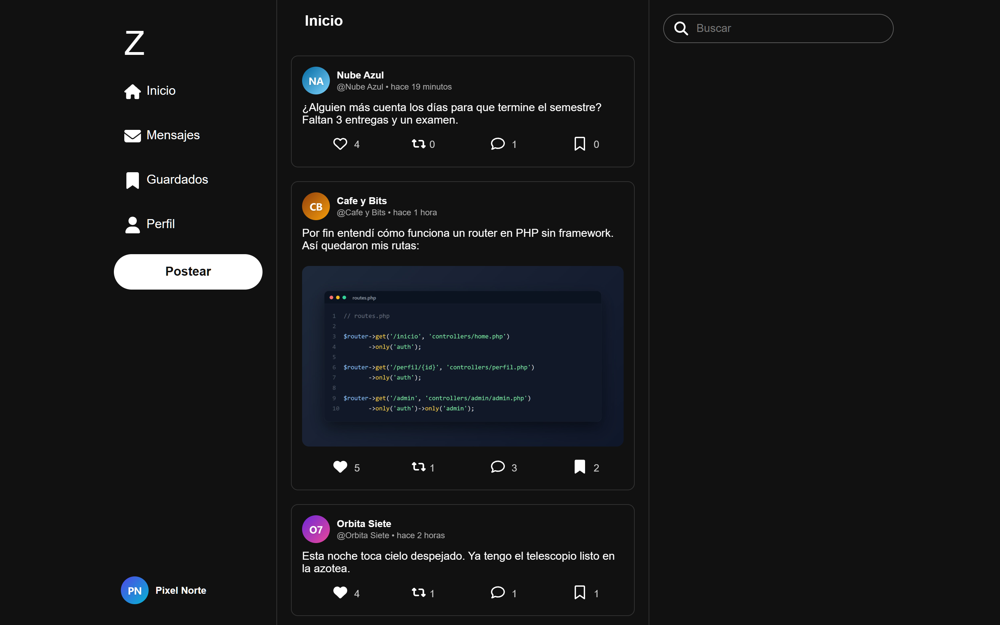
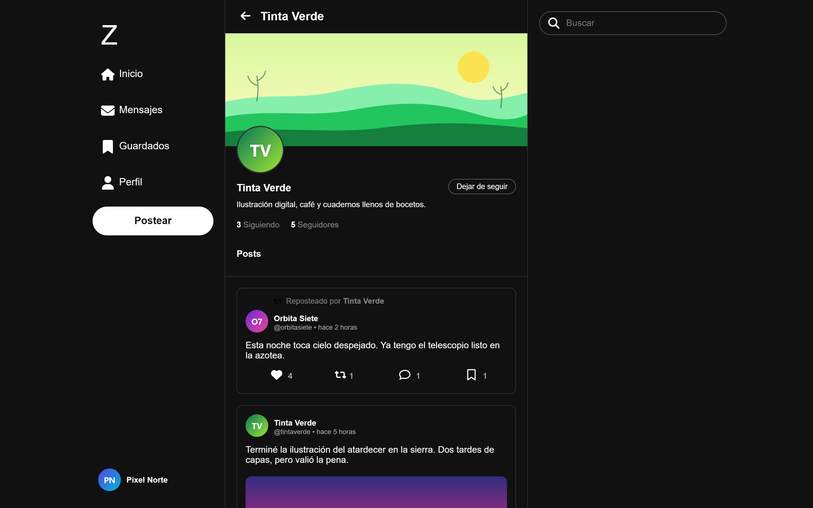
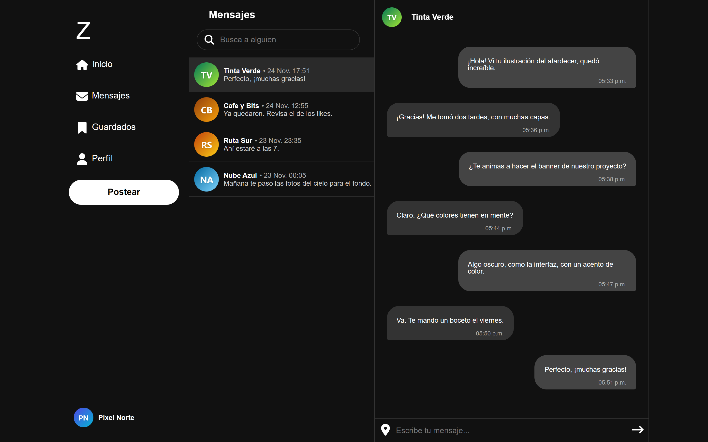
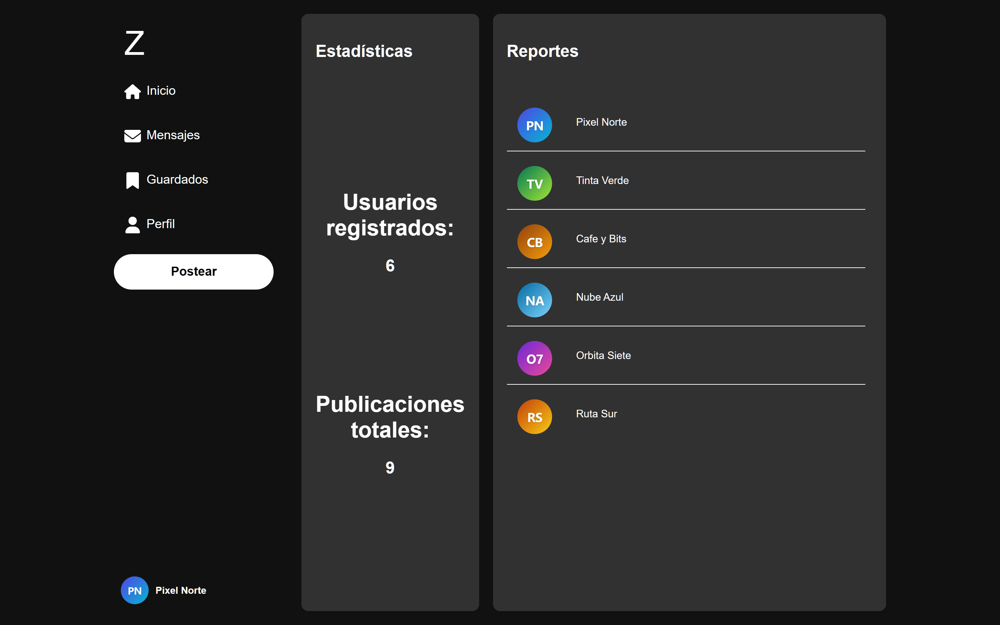

# Z — red social web

Red social inspirada en X/Twitter, hecha como proyecto universitario en equipo para las materias de Programación Web de Capa Intermedia y Bases de Datos Multimedia (2025).

La interfaz imita a propósito la de X: el objetivo del proyecto no era el diseño visual, sino construir la lógica completa de una red social, desde el enrutamiento y las sesiones hasta el modelo de datos.

## Capturas

Z corriendo en local con usuarios, publicaciones y mensajes de prueba inventados.

<table>
  <tr>
    <td width="50%"><br><b>Inicio:</b> el feed, con likes, reposts, respuestas y guardados.</td>
    <td width="50%"><br><b>Perfil:</b> banner, biografía, seguidores y reposts.</td>
  </tr>
  <tr>
    <td width="50%"><br><b>Mensajes:</b> chats ordenados por actividad y la conversación abierta.</td>
    <td width="50%"><br><b>Administración:</b> estadísticas del sitio y lista de usuarios.</td>
  </tr>
</table>

## Qué hace

- Registro e inicio de sesión con validación en cliente y servidor; contraseñas con `password_hash`.
- Publicaciones con texto, imagen o video (jpg, png, gif, mp4, webm, ogg; hasta 50 MB).
- Likes, reposts, guardados y respuestas en hilo.
- Seguir y dejar de seguir usuarios; perfil con foto, banner y biografía editables.
- Mensajes privados entre usuarios, con lista de chats ordenada por actividad.
- Búsqueda de usuarios.
- Panel de administración con estadísticas del sitio y lista de usuarios.

## Cómo está hecho

**Backend (PHP 8, sin framework)**

- Arquitectura MVC propia: `Core/Router.php` (rutas con parámetros), `Core/Container.php` (inyección de dependencias), `Core/Validator.php`.
- Middleware por ruta para invitados, usuarios autenticados y administradores (`Core/Middleware`).
- Acceso a datos con PDO y consultas preparadas.
- Los datos de conexión se leen de variables de entorno (`config.php`).

**Base de datos (MySQL 8)** — `database/schema.sql`

- 14 tablas, con tablas intermedias para likes, reposts y seguidores.
- 23 procedimientos almacenados para la lógica principal: alternar like, repost, guardado y seguimiento en una sola llamada, crear publicaciones con multimedia, crear u obtener un chat, armar el feed de inicio y de perfil.
- 11 vistas para las consultas que se repiten (publicación con autor y multimedia, detalles de perfil, chats con su último mensaje).
- 3 triggers; por ejemplo, actualizar la actividad de un chat cuando llega un mensaje nuevo.
- Funciones para las estadísticas del panel de administración.

**Frontend**

- Vistas en PHP con HTML, CSS y JavaScript sin librerías.
- Likes, reposts, guardados, seguimientos y mensajes se envían con `fetch` sin recargar la página.

## Correr en local

Requisitos: PHP 8 con la extensión `pdo_mysql` y MySQL 8.

1. Crea la base de datos ejecutando `database/schema.sql` completo (tablas, vistas, procedimientos y triggers).
2. Configura la conexión. Por defecto se usa `127.0.0.1:3306`, usuario `root` sin contraseña y la base `PROYECTO_Z2`. Para cambiarlo, define estas variables de entorno:

   | Variable | Por defecto |
   | --- | --- |
   | `DB_HOST` | `127.0.0.1` |
   | `DB_PORT` | `3306` |
   | `DB_NAME` | `PROYECTO_Z2` |
   | `DB_USER` | `root` |
   | `DB_PASSWORD` | *(vacía)* |
   | `DB_SSL_CA` | *(opcional)* ruta a un certificado CA para conexiones con SSL |

3. Levanta el servidor:

   ```bash
   php -S localhost:8000 -t public
   ```

4. Abre <http://localhost:8000> y regístrate.

Para entrar al panel de administración, cambia el tipo de un usuario a administrador:

```sql
UPDATE Usuario SET TipoUsuario = 2 WHERE UsuarioID = 1;
```

## Equipo

- **Miguel Reyes**: estructura del proyecto, backend en PHP, frontend y conexión con la base de datos; refinamiento del modelo de datos.
- **Felix Coronado**: diseño de la base de datos, procedimientos almacenados y triggers.

Este repositorio es una copia limpia del proyecto original, sin credenciales ni archivos de prueba.
